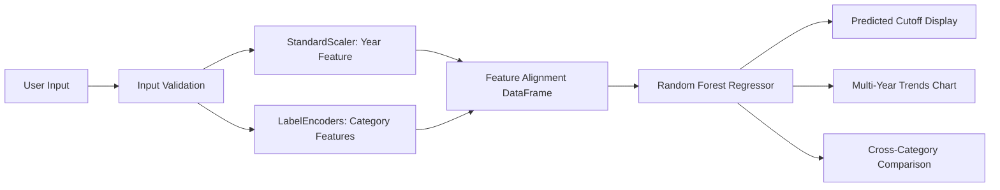

# 🎓 Academic Horizon: University Admission Cutoff Predictor

[](https://streamlit.io/)
[](https://python.org)
[](https://scikit-learn.org/)
[](#)

An intelligent machine learning web application that accurately predicts university admission cutoff ranks and qualifying exam scores across multiple admission cycles, reservation seat quotas, and merit categories.

---

## 🌟 Key Features

- **Accurate ML Inference**: Powered by a trained Random Forest Regressor calibrated across historical university admission data.
- **Dual Cutoff Metrics**: Predicts both **Cutoff Ranks** (merit rank ceiling) and **Cutoff Scores** (entrance exam score marks).
- **Multi-Year Trend Analysis**: Interactive time-series visual charts comparing cutoff trajectories across 2024–2027.
- **Cross-Category Benchmarking**: Side-by-side comparison across seat categories (`General Quota`, `Open Merit`, `Special Fee Course`).
- **Counseling Playbook**: Actionable choice-filling strategies, preference ordering, and document verification checklists.
- **Modern Glassmorphic UI**: High-fidelity responsive design with custom styling, badges, and instant scenario presets.

---

## 🏗️ System Architecture



---

## 🚀 Running Locally

### 1. Clone the repository
```bash
git clone https://github.com/prasunshamkule-lab/Academic-Horizon-University-Cutoff-Predictor.git
cd Academic-Horizon-University-Cutoff-Predictor
```

### 2. Set up virtual environment (optional but recommended)
```bash
python -m venv venv
# Windows:
venv\Scripts\activate
# Linux/macOS:
source venv/bin/activate
```

### 3. Install dependencies
```bash
pip install -r requirements.txt
```

### 4. Launch the Streamlit App
```bash
streamlit run app.py
```

The application will start at `http://localhost:8501`.

---

## ☁️ Deploying to Streamlit Community Cloud

1. Push your changes to your GitHub repository (`main` branch).
2. Visit [share.streamlit.io](https://share.streamlit.io/) and log in with GitHub.
3. Click **New app** and select:
   - **Repository**: `prasunshamkule-lab/Academic-Horizon-University-Cutoff-Predictor`
   - **Branch**: `main`
   - **Main file path**: `app.py`
4. Click **Deploy!** — Streamlit Cloud will automatically read `requirements.txt` and launch the application.

---

## 📦 Project Structure

```
├── .streamlit/
│   └── config.toml        # Streamlit UI theme and server configuration
├── app.py                 # Core Streamlit web application & prediction interface
├── model.pkl              # Serialized Random Forest Regressor
├── scaler.pkl             # StandardScaler for admission cycle years
├── encoders.pkl           # LabelEncoders for categorical features
├── requirements.txt       # Python package dependencies
├── .gitignore             # Git ignore patterns
└── README.md              # Project documentation
```

---

## 📄 License
This project is licensed under the MIT License - see the [LICENSE](LICENSE) file for details.